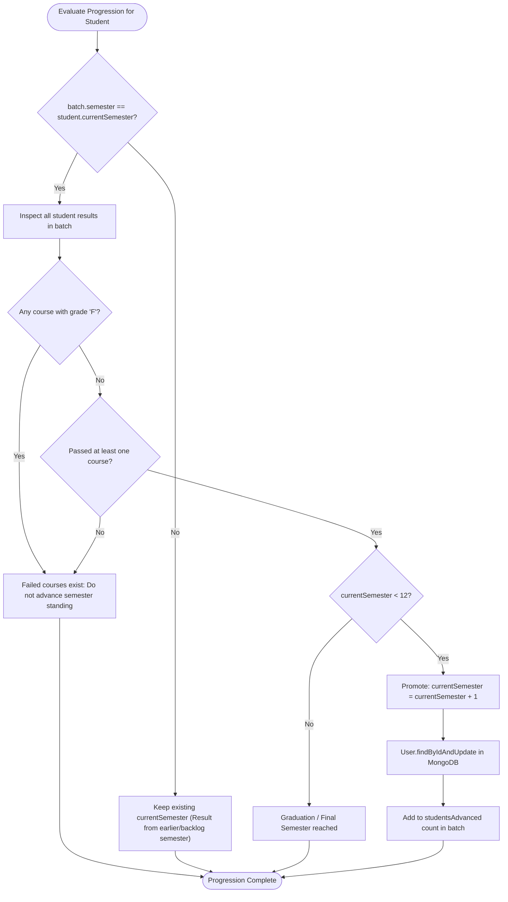

# ALGORITHMS, BUSINESS LOGIC & WORKFLOW SPECIFICATIONS

---

## 1. Deterministic SHA-256 Credit Integrity Seal Engine

### 1.1 Implementation Status
- **Status:** Fully implemented and verified.
- **Source File:** `server/utils/hashHelper.js`
- **Primary Functions:** `generateCreditHash`, `verifyCreditIntegrity`
- **Execution Triggers:** Automatically invoked in `academicCreditSchema.pre('validate')` and in controllers whenever credit records are created or updated.

### 1.2 Mathematical Formulation & Input Specification
The integrity seal creates a non-forgeable cryptographic fingerprint over 7 immutable academic parameters:
$$\text{Payload} = \text{"NEP-CREDIT-INTEGRITY::student="} \parallel S \parallel \text{"|course="} \parallel C \parallel \text{"|institution="} \parallel I \parallel \text{"|credits="} \parallel Cr \parallel \text{"|grade="} \parallel G \parallel \text{"|semester="} \parallel Sem \parallel \text{"|year="} \parallel Y$$
$$\text{IntegritySeal} = \text{SHA-256}(\text{Payload})$$

- **Inputs:**
  - `studentId` ($S$): String or MongoDB ObjectId.
  - `courseId` ($C$): String or MongoDB ObjectId.
  - `institutionId` ($I$): String or MongoDB ObjectId.
  - `credits` ($Cr$): Integer between 1 and 20.
  - `grade` ($G$): Uppercase grade letter (e.g., `'O'`, `'A+'`, `'B'`).
  - `semester` ($Sem$): Integer between 1 and 12.
  - `academicYear` ($Y$): String format (e.g., `'2024-25'`).
- **Output:** 64-character hexadecimal SHA-256 string.

### 1.3 Pseudocode
```python
function generateCreditHash(studentId, courseId, institutionId, credits, grade, semester, academicYear):
    stdStr = string(studentId)
    crsStr = string(courseId)
    instStr = string(institutionId)
    crdNum = integer(credits)
    grdStr = uppercase(trim(grade))
    semNum = integer(semester)
    yrStr = trim(academicYear)
    
    payload = "NEP-CREDIT-INTEGRITY::student=" + stdStr + 
              "|course=" + crsStr + 
              "|institution=" + instStr + 
              "|credits=" + crdNum + 
              "|grade=" + grdStr + 
              "|semester=" + semNum + 
              "|year=" + yrStr
              
    return crypto.sha256_hex(payload)

function verifyCreditIntegrity(creditRecord):
    calculatedHash = generateCreditHash(
        creditRecord.studentId,
        creditRecord.courseId,
        creditRecord.institutionId,
        creditRecord.credits,
        creditRecord.grade,
        creditRecord.semester,
        creditRecord.academicYear
    )
    return calculatedHash == creditRecord.integrityHash
```

### 1.4 Edge Cases & Test Coverage
- **Edge Cases Handled:** Leading/trailing whitespace on grades or academic years; MongoDB ObjectId types vs. raw strings; integer conversion.
- **Verification:** Tested in `server/testAllFeaturesComprehensive.js` (Section 1.3) and `server/testSemesterResultsAndProgression.js` (Section 6). If any stored credit field is altered directly in the database without recomputing the hash, `verifyCreditIntegrity` returns `false`.

---

## 2. Bulk Examination Ingestion & Automatic Credit Conversion Pipeline

### 2.1 Implementation Status
- **Status:** Fully implemented and verified.
- **Source File:** `server/controllers/resultImportController.js`
- **Primary Functions:** `previewResultsImport`, `confirmResultsImport`

### 2.2 Processing Architecture
The pipeline processes spreadsheets through a two-phase transactional staging design:
1. **Preview Phase (`POST /api/institution/results/preview`):** Parses rows into memory using `multer.memoryStorage()` and `xlsx.read`. Validates student and course references against MongoDB without persisting results. Flags duplicates and previously awarded credits. Returns a comprehensive preview summary.
2. **Confirmation Phase (`POST /api/institution/results/confirm`):** Valid rows are committed into `SemesterResult`. Passing grades are converted into `AcademicCredit` records with SHA-256 seals. The semester progression algorithm advances eligible students.

```
                  ┌──────────────────────────────────────────────┐
                  │ Academic Officer Uploads Spreadsheet (.xlsx) │
                  └──────────────────────┬───────────────────────┘
                                         │
                                         ▼
                  ┌──────────────────────────────────────────────┐
                  │ Memory Buffer Parsing via Multer & SheetJS   │
                  └──────────────────────┬───────────────────────┘
                                         │
                                         ▼
                  ┌──────────────────────────────────────────────┐
                  │ Pre-Validation against MongoDB:             │
                  │ - Student ABC ID exists & belongs to inst   │
                  │ - Course Code is cataloged in curriculum    │
                  │ - File duplicates & previous credits check   │
                  └──────────────────────┬───────────────────────┘
                                         │
                                         ▼
                  ┌──────────────────────────────────────────────┐
                  │ Save Batch in PREVIEW Status                │
                  └──────────────────────┬───────────────────────┘
                                         │
                                         ▼
                     [Academic Officer Reviews & Clicks Confirm]
                                         │
                                         ▼
                  ┌──────────────────────────────────────────────┐
                  │ 1. Create Authoritative SemesterResults      │
                  │ 2. If Pass -> Award SHA-256 AcademicCredits  │
                  │ 3. Evaluate Progression (Sem N -> Sem N+1)   │
                  │ 4. Write Immutable System AuditLog Entry     │
                  └──────────────────────────────────────────────┘
```

### 2.3 Pseudocode (Confirmation & Credit Conversion)
```python
function confirmResultsImport(batchId, institutionId, officerId):
    batch = findBatch(batchId, institutionId)
    if batch.status == "CONFIRMED":
        raise Error("Batch already confirmed")
        
    validItems = filter(batch.items, item.isValid and not item.isAlreadyProcessed)
    
    for item in validItems:
        student = findStudent(item.studentId)
        course = findCourse(item.courseId)
        
        isPass = item.grade in ['O', 'A+', 'A', 'B+', 'B', 'C', 'P']
        authoritativeCredits = course.credits if isPass else 0
        
        # 1. Create SemesterResult
        resultRecord = createSemesterResult({
            studentId: student._id,
            studentAbcId: student.studentId,
            courseId: course._id,
            marks: item.marks,
            grade: item.grade,
            creditsEarned: authoritativeCredits,
            resultStatus: "PASS" if isPass else "FAIL",
            importBatchId: batch._id
        })
        
        # 2. Auto-award AcademicCredit with SHA-256 seal if passed
        if isPass and not creditExists(student._id, course._id, batch.semester):
            hash = generateCreditHash(student._id, course._id, institutionId, 
                                      authoritativeCredits, item.grade, batch.semester, batch.academicYear)
            creditRecord = createAcademicCredit({
                studentId: student._id,
                courseId: course._id,
                institutionId: institutionId,
                credits: authoritativeCredits,
                grade: item.grade,
                semester: batch.semester,
                academicYear: batch.academicYear,
                verificationStatus: "verified",
                integrityHash: hash,
                semesterResultId: resultRecord._id
            })
            resultRecord.creditId = creditRecord._id
            resultRecord.save()
            
    # 3. Evaluate Progression
    advanceEligibleStudents(batch.semester, validItems)
    batch.status = "CONFIRMED"
    batch.save()
```

---

## 3. Automatic Semester Progression Evaluation Algorithm

### 3.1 Implementation Status
- **Status:** Fully implemented and verified.
- **Source File:** `server/controllers/resultImportController.js` (lines 806–833)
- **Primary Function:** Inlined within `confirmResultsImport`

### 3.2 Logic & Governing Policy
Under NEP 2020 semester progression guidelines:
1. A student's semester standing should advance only when examination results correspond to their **active semester** (`batch.semester == student.currentSemester`).
2. The student must have passed **all registered courses** for that semester (`hasFailedCourse == false` and `hasPassedAtLeastOne == true`).
3. If a student receives an `'F'` grade in any course in that examination batch, they are not promoted; their `currentSemester` remains unchanged, and they are recorded with backlog/supplementary status.
4. Upper bound guard: Promotion stops at semester 12 (`currentSemester < 12`).

### 3.3 Flowchart


---

## 4. Audited Result Correction & Integrity Resealing

### 4.1 Implementation Status
- **Status:** Fully implemented and verified.
- **Source File:** `server/controllers/resultImportController.js`
- **Primary Function:** `correctResult` (`PUT /api/institution/results/:id/correct`)

### 4.2 Algorithm & Lifecycle
When an institutional academic council approves a grade re-evaluation or mark correction:
1. Validates that the updating officer provides a non-empty, mandatory **audited reason**.
2. Archives the entire previous state (`previousMarks`, `previousGrade`, `previousCredits`, `previousStatus`, `updatedBy`, `updatedAt`, `reason`) into the `correctionHistory` subdocument array.
3. Updates `marks`, recalculates `grade`, and sets `isCorrected = true`.
4. **Credit Reconciliation:**
   - If a student changes from **Fail to Pass**, an `AcademicCredit` record is created or updated with authoritative credits, and a new SHA-256 seal is generated.
   - If a student changes from **Pass to Fail**, any previously issued `AcademicCredit` record is deleted/revoked to prevent fraudulent accumulation.
5. Records an immutable `AuditLog` entry.

---

## 5. Smart Credit Pre-Validation Suite

### 5.1 Implementation Status
- **Status:** Fully implemented and verified.
- **Source File:** `server/controllers/validationController.js`
- **Primary Function:** `validateCreditPayload` (`POST /api/credits/validate`)

### 5.2 Validation Rules Executed
1. **Student Verification:** Checks MongoDB ObjectId format, verifies user exists, and checks that `role == 'student'`.
2. **Institution Authorization:** Verifies that the issuing institution exists and holds active accreditation status.
3. **Course Catalog Verification:** Confirms course ID exists in the university's active catalog.
4. **Credit Value Bounds:** Enforces $1 \le \text{credits} \le 30$.
5. **Grade Schema Validation:** Enforces standard NEP grade set: `['O', 'A+', 'A', 'B+', 'B', 'C', 'P', 'F', 'S']`.
6. **Academic Period Validation:** Enforces $1 \le \text{semester} \le 12$ and non-empty academic year string.
7. **Duplicate Ledger Check:** Queries `AcademicCredit` for existing records matching `{studentId, courseId, semester, academicYear}`.
8. **Cryptographic Pre-Seal:** Computes and returns the anticipated SHA-256 seal before database write.

---

## 6. Credit Acceptance Policy & Historical Versioning Engine

### 6.1 Implementation Status
- **Status:** Fully implemented and verified.
- **Source File:** `server/controllers/institutionController.js` (`updateInstitutionPolicy`), `server/models/CreditPolicy.js`
- **Primary Functions:** `updateInstitutionPolicy`, `CreditPolicy.getEffectivePolicy`

### 6.2 Versioning Logic
1. When a university updates its acceptance rules (`minGrade`, `minEquivalency`, `maxCredits`):
   - The current active configuration is pushed into the `policyHistory` embedded subdocument array along with an audit timestamp and the editor's user ID.
   - A semantic version increment is evaluated: `v1.0` $\rightarrow$ `v2.0` (or user-specified version string).
   - The root document fields are overwritten with the new rules.
2. In-flight transfer requests capture the `policyVersionUsed` at evaluation time to ensure historical decision explainability.

---

## 7. NEP 2020 Exit Benchmark Eligibility Tracker

### 7.1 Implementation Status
- **Status:** Fully implemented and verified.
- **Source File:** `server/controllers/eligibilityController.js`
- **Primary Function:** `getEligibilityStatus` (`GET /api/eligibility`)

### 7.2 Benchmark Thresholds & Calculations
The tracker sums all credits where `verificationStatus == 'verified'` and computes progress against 4 official NEP milestones:

$$\text{ProgressPercentage} = \min\left(100, \text{round}\left(\frac{\text{VerifiedCredits}}{160} \times 100\right)\right)$$

| Qualification Milestone | Minimum Required Verified Credits | Eligibility Formula |
| :--- | :---: | :--- |
| **Undergraduate Certificate** | 40 Credits | $\text{Credits} \ge 40 \implies \text{Eligible}$ |
| **Undergraduate Diploma** | 80 Credits | $\text{Credits} \ge 80 \implies \text{Eligible}$ |
| **NEP 3-Year UG Degree** | 140 Credits | $\text{Credits} \ge 140 \implies \text{Eligible}$ |
| **4-Year Bachelor Degree (Honours/Research)** | 160 Credits | $\text{Credits} \ge 160 \implies \text{Eligible}$ |

---

## 8. Prerequisite-Aware Course Recommendation Engine

### 8.1 Implementation Status
- **Status:** Fully implemented and verified.
- **Source File:** `server/controllers/recommendationController.js`
- **Primary Function:** `getCourseRecommendations` (`GET /api/recommendations`)

### 8.2 Algorithm & Explainability Scoring
1. Queries the student's completed academic credits to build sets of completed course IDs and course codes.
2. Retrieves all active catalog courses across the platform.
3. Filters out any courses the student has already completed.
4. Evaluates prerequisites:
   - If a course defines prerequisites, verifies whether all required course codes exist in the student's completed set.
   - If any prerequisite is missing, the course is marked non-recommended with an explanatory reason.
5. Assigns an explainability match score:
   - **Home University Core Requirements:** Match score = 95. Rationale: *"Core requirement from your home institution worth X credits."*
   - **Partner University Multidisciplinary Electives:** Match score = 85. Rationale: *"Elective credit opportunity from partner institution transferrable under NEP guidelines."*
6. Sorts recommendations in descending order of match score.
