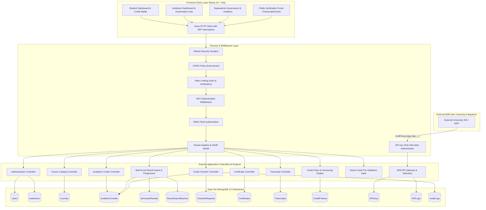
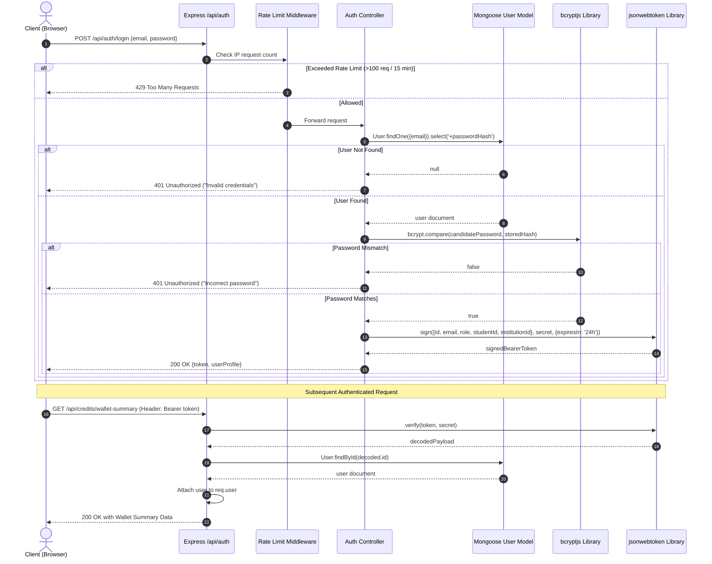
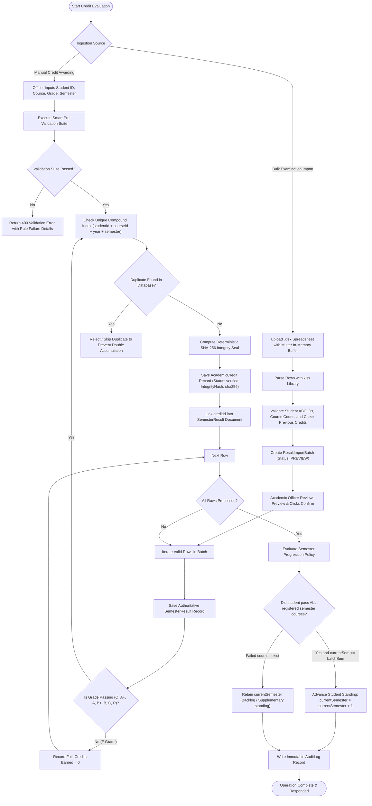
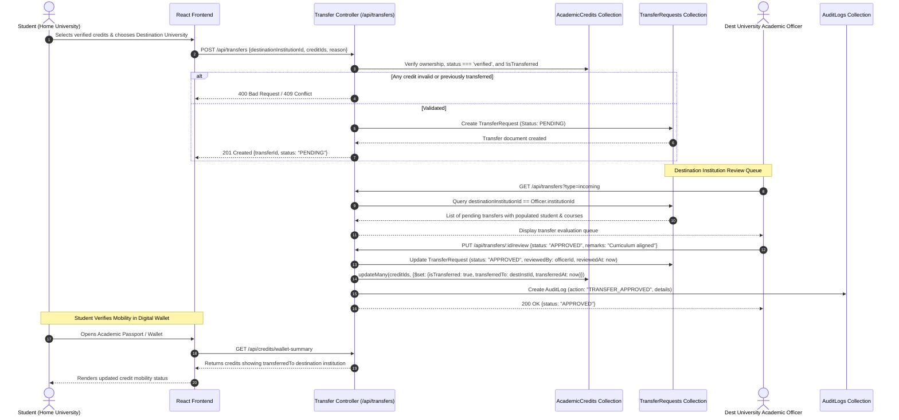

# SYSTEM ARCHITECTURE & DESIGN DOCUMENTATION

---

## 1. Architectural Narrative & System Overview

The **NEP Aligned Standardized Academic Credit Accumulation Hub** is engineered as a multi-tier, multi-tenant distributed academic exchange platform. It enables seamless inter-university student mobility under the National Education Policy (NEP 2020) framework.

The architecture separates concerns across three primary tiers:
1. **Presentation Tier (React Client):** A responsive Single Page Application (SPA) built with React 18, Vite, Tailwind CSS, and React Router v6. It provides distinct, role-tailored user experiences for Students, Institutions, and Central Administrators.
2. **Application & API Gateway Tier (Express REST Server):** A stateless Node.js / Express.js RESTful service implementing Role-Based Access Control (RBAC), multi-tenant data isolation, rate limiting, and an automated cryptographic sealing engine. In addition to standard user-facing routes, it houses the B2B Cross-Institutional API Gateway that handles machine-to-machine integration with external university ERPs.
3. **Data Tier (MongoDB Document Store):** A high-performance, non-relational database managed via Mongoose ODM. It persists 13 collections configured with compound indexes to enforce data integrity, uniqueness constraints, and tenant isolation.

---

## 2. Tier-to-Tier Communication Mechanisms

### 2.1 React Frontend to Express Backend
- **Transport Protocol:** Asynchronous HTTPS/HTTP REST communication managed by an Axios instance (`client/src/services/api.js`).
- **Base URL Routing:** Requests target `/api` or versioned endpoints (`/api/v1`).
- **Authentication Headers:** An Axios request interceptor extracts the JSON Web Token from browser `localStorage` (`nep_token`) and injects it into the HTTP `Authorization: Bearer <token>` header for all authenticated requests.
- **Unified Error Normalization:** An Axios response interceptor catches HTTP error codes (400, 401, 403, 404, 409, 500). If a 401 Unauthorized status is returned, the client automatically flushes local credentials and redirects the user to the `/login` view.

### 2.2 Express Backend to MongoDB
- **Object Data Modeling (ODM):** Mongoose establishes a managed persistent connection pool (`server/config/db.js`).
- **Data Integrity & Hooks:**
  - `userSchema.pre('save')`: Hashes plain-text passwords using `bcryptjs` (work factor 12) before persistence.
  - `academicCreditSchema.pre('validate')`: Automatically calculates a 64-character hexadecimal SHA-256 integrity seal whenever credits or grades are modified.
- **Compound Indexing:** MongoDB indexes prevent duplicate registrations, enforce unique course codes per institution, and prevent students from receiving duplicate credits for the same course in the same semester.

---

## 3. End-to-End Core Workflow Descriptions

### 3.1 Authentication & Authorization Flow
1. User submits credentials via `POST /api/auth/login`.
2. Controller retrieves the user record by email, explicitly including the hidden `passwordHash` field via `.select('+passwordHash')`.
3. `user.comparePassword()` invokes `bcrypt.compare` to verify the candidate password against the work-factor-12 hash.
4. Upon verification, `generateToken()` creates an HMAC-SHA256 signed JWT containing user ID, role, student ABC ID, and institution ID with a 24-hour expiration window.
5. In subsequent requests, `authenticate` middleware decodes the JWT, verifies active account status in MongoDB, and attaches the user document to `req.user`.
6. Downstream `authorize(role)` and `requireInstitutionScope()` middleware verify that the user's role is permitted and that institution representatives cannot access data belonging to other universities.

### 3.2 Bulk Result Ingestion & Automatic Credit Progression Flow
1. Institution academic officers upload a standardized Excel spreadsheet (`.xlsx`) via `POST /api/institution/results/preview`.
2. Multer buffers the file in memory (no disk residue), and `xlsx.read` extracts row records.
3. The preview engine performs multi-point validation against MongoDB:
   - Validates that student ABC IDs exist and belong strictly to the uploading university.
   - Validates that course codes are cataloged under the institution's curriculum.
   - Detects in-spreadsheet duplicates and checks if credit was already awarded.
4. When the officer clicks "Confirm Import" (`POST /api/institution/results/confirm`):
   - Authoritative `SemesterResult` records are created for all valid rows.
   - Passing grades automatically generate `AcademicCredit` records with SHA-256 integrity seals.
   - The progression engine evaluates whether the student passed all courses for their current semester. If so, `currentSemester` advances from $N$ to $N+1$.
   - An immutable `AuditLog` entry is recorded.

### 3.3 Cross-Institutional Credit Transfer Workflow
1. A student selects verified academic credits and a target destination institution via `POST /api/transfers`.
2. The server verifies credit ownership, ensures all selected credits are marked `verified`, confirms credits have not been previously transferred, and creates a `TransferRequest` with status `PENDING`.
3. The destination institution views the request in their incoming queue (`GET /api/transfers?type=incoming`).
4. The destination academic officer reviews the student's credit authenticity and syllabus equivalency, updating the status to `APPROVED`, `CONDITIONAL_APPROVAL`, or `REJECTED` (`PUT /api/transfers/:id/review`).
5. Upon approval:
   - Associated `AcademicCredit` records are updated: `isTransferred = true`, `transferredTo = destinationInstitutionId`, `transferredAt = new Date()`.
   - The student's academic passport and transcript immediately reflect the updated institutional ownership.
   - An immutable audit trail entry is generated.

### 3.4 B2B API Gateway Request Flow
1. External university ERP systems transmit requests with an `X-API-Key: nep_live_...` header.
2. The `authenticateApiKey(scope)` middleware computes the SHA-256 hash of the incoming key and queries the `APIKey` collection.
3. The gateway verifies that the key is active and possesses the required scope (`read:credits`, `submit:credits`, `verify:certificates`, `read:students`).
4. The request is processed, and response metrics (endpoint, HTTP method, response status, latency in milliseconds, client IP) are logged to `APILog`.

---

## 4. Architectural Mermaid Diagrams

### Diagram 1: Overall System Architecture



---

### Diagram 2: Use-Case Diagram

```mermaid
flowchart LR
    subgraph Actors
        Student["Student Actor"]
        Institution["Institution Academic Officer"]
        Admin["Superadmin / Regulator"]
        PublicUser["Public Verifier / Employer"]
        ExternalERP["External University ERP System"]
    end

    subgraph Student_Use_Cases ["Student Capabilities"]
        UC_S1["View Digital Academic Credit Wallet"]
        UC_S2["Inspect Semester-Wise Credit Timeline"]
        UC_S3["Track NEP 2020 Exit Benchmarks"]
        UC_S4["Submit Inter-University Credit Transfer"]
        UC_S5["Simulate Transfer Acceptance Probability"]
        UC_S6["Generate Cryptographically Sealed Transcript"]
        UC_S7["View Recommended Courses & Prereqs"]
    end

    subgraph Institution_Use_Cases ["Institution Capabilities"]
        UC_I1["Manage Institution Course Catalog"]
        UC_I2["Upload Semester Exam Spreadsheet (Excel)"]
        UC_I3["Preview & Confirm Bulk Results Import"]
        UC_I4["Audit & Correct Semester Exam Scores"]
        UC_I5["Award Individual Verified Academic Credits"]
        UC_I6["Review & Decide Incoming Transfer Requests"]
        UC_I7["Author & Version Credit Acceptance Policies"]
        UC_I8["Issue & Revoke Academic Micro-Credentials"]
        UC_I9["Generate Scoped B2B API Keys"]
    end

    subgraph Admin_Use_Cases ["Administrator Capabilities"]
        UC_A1["Inspect National System Telemetry & KPIs"]
        UC_A2["Accredit & Verify Participating Universities"]
        UC_A3["Audit Global Credit Transactions"]
        UC_A4["Inspect Platform Security Audit Trail"]
        UC_A5["Monitor B2B API Gateway Health & Latency"]
    end

    subgraph Public_Use_Cases ["Public Verification"]
        UC_P1["Verify Certificate Authenticity by ID"]
        UC_P2["Verify Transcript Authenticity by QR/Code"]
    end

    subgraph B2B_Use_Cases ["Machine-to-Machine Integration"]
        UC_B1["Programmatic Query of Student Credits"]
        UC_B2["Programmatic Submission of Academic Credits"]
        UC_B3["B2B Certificate Seal Verification"]
    end

    Student --> UC_S1
    Student --> UC_S2
    Student --> UC_S3
    Student --> UC_S4
    Student --> UC_S5
    Student --> UC_S6
    Student --> UC_S7

    Institution --> UC_I1
    Institution --> UC_I2
    Institution --> UC_I3
    Institution --> UC_I4
    Institution --> UC_I5
    Institution --> UC_I6
    Institution --> UC_I7
    Institution --> UC_I8
    Institution --> UC_I9

    Admin --> UC_A1
    Admin --> UC_A2
    Admin --> UC_A3
    Admin --> UC_A4
    Admin --> UC_A5

    PublicUser --> UC_P1
    PublicUser --> UC_P2

    ExternalERP --> UC_B1
    ExternalERP --> UC_B2
    ExternalERP --> UC_B3
```



---

### Diagram 3: Authentication Sequence Diagram



---

### Diagram 4: Academic Credit Processing Flow



---

### Diagram 5: Credit Transfer Workflow



---

### Diagram 6: Database Entity Relationship Diagram (ERD)

```mermaid
erDiagram
    INSTITUTION ||--o{ USER : enrolls_or_employs
    INSTITUTION ||--o{ COURSE : catalogs
    INSTITUTION ||--o{ ACADEMIC_CREDIT : awards
    INSTITUTION ||--o{ CREDIT_POLICY : defines
    INSTITUTION ||--o{ API_KEY : issues
    INSTITUTION ||--o{ API_LOG : generates_telemetry

    USER ||--o{ ACADEMIC_CREDIT : earns
    USER ||--o{ SEMESTER_RESULT : receives
    USER ||--o{ CERTIFICATE : receives
    USER ||--o{ TRANSCRIPT : receives
    USER ||--o{ TRANSFER_REQUEST : initiates_as_student

    COURSE ||--o{ ACADEMIC_CREDIT : specifies_curriculum
    COURSE ||--o{ SEMESTER_RESULT : evaluates_score

    ACADEMIC_CREDIT ||--o| CERTIFICATE : secures_credential
    SEMESTER_RESULT ||--o| ACADEMIC_CREDIT : auto_converts_to

    INSTITUTION ||--o{ TRANSFER_REQUEST : source_university
    INSTITUTION ||--o{ TRANSFER_REQUEST : destination_university

    RESULT_IMPORT_BATCH ||--o{ SEMESTER_RESULT : contains
    RESULT_IMPORT_BATCH ||--o{ ACADEMIC_CREDIT : populates

    USER ||--o{ AUDIT_LOG : executes_action

    INSTITUTION {
        ObjectId _id PK
        string name
        string code UK "e.g. BIT001, KIT002"
        string type "STATE_UNIVERSITY, CENTRAL_UNIVERSITY..."
        string contactEmail
        string naacAccreditation "A+, A++..."
        string verificationStatus "VERIFIED, PENDING"
        boolean isActive
    }

    USER {
        ObjectId _id PK
        string name
        string email UK
        string passwordHash "bcrypt salted"
        string role "student, institution, admin"
        string studentId "ABC ID / Roll Number"
        number currentSemester "1 to 12"
        ObjectId institutionId FK
        string institutionCode
        boolean isActive
    }

    COURSE {
        ObjectId _id PK
        string courseCode "CS501, 22MA101"
        string courseName
        number credits "1 to 20"
        string department
        number semester "1 to 12"
        ObjectId institutionId FK
        boolean isActive
    }

    ACADEMIC_CREDIT {
        ObjectId _id PK
        ObjectId studentId FK
        ObjectId courseId FK
        ObjectId institutionId FK
        number credits "Authoritative value"
        string grade "O, A+, A, B+, B, C, P, F"
        number semester
        string academicYear "2024-25"
        string verificationStatus "verified, pending, rejected"
        string integrityHash "Deterministic SHA-256 seal"
        boolean isTransferred
        ObjectId transferredTo FK
        ObjectId transferRequestId FK
    }

    SEMESTER_RESULT {
        ObjectId _id PK
        ObjectId studentId FK
        string studentAbcId
        ObjectId institutionId FK
        ObjectId courseId FK
        string courseCode
        number marks "0 to 100"
        string grade
        number creditsEarned
        string resultStatus "PASS, FAIL"
        boolean isCorrected
        ObjectId importBatchId FK
        ObjectId creditId FK
    }

    RESULT_IMPORT_BATCH {
        ObjectId _id PK
        string batchId UK
        ObjectId institutionId FK
        string academicYear
        number semester
        ObjectId uploadedBy FK
        number totalRows
        number validRows
        number processedRows
        number creditsAwarded
        number studentsAdvanced
        string status "PREVIEW, CONFIRMED"
    }

    TRANSFER_REQUEST {
        ObjectId _id PK
        ObjectId studentId FK
        ObjectId sourceInstitutionId FK
        ObjectId destinationInstitutionId FK
        ObjectId[] creditIds FK
        number totalCredits
        string status "PENDING, APPROVED, REJECTED..."
        string policyVersionUsed
        ObjectId reviewedBy FK
        date reviewedAt
        string remarks
        string rejectionReason
    }

    CERTIFICATE {
        ObjectId _id PK
        string certificateId UK
        ObjectId studentId FK
        ObjectId institutionId FK
        ObjectId courseId FK
        ObjectId academicCreditId FK
        string title
        string integrityHash "Deterministic SHA-256"
        string verificationStatus "verified, pending, revoked"
        date revokedAt
    }

    TRANSCRIPT {
        ObjectId _id PK
        string transcriptId UK
        string verificationCode UK "Public verification token"
        ObjectId studentId FK
        ObjectId institutionId FK
        number totalCredits
        number verifiedCredits
        string status "generated, revoked"
        string integrityHash "Deterministic SHA-256"
    }

    CREDIT_POLICY {
        ObjectId _id PK
        ObjectId institutionId FK UK
        string version "v1.0, v2.0"
        string minGrade "B"
        number minEquivalency "80%"
        number maxCredits "60"
        Object[] policyHistory "Embedded versions"
    }

    API_KEY {
        ObjectId _id PK
        string keyId UK
        string keyHash UK "SHA-256 of secret"
        string lastFour "Last 4 chars"
        ObjectId institutionId FK
        string[] scopes "read:credits, submit:credits..."
        boolean isActive
        date lastUsedAt
    }

    API_LOG {
        ObjectId _id PK
        string logId UK
        ObjectId apiKeyId FK
        ObjectId institutionId FK
        string endpoint
        string method
        number statusCode
        number responseTimeMs
        string ipAddress
    }

    AUDIT_LOG {
        ObjectId _id PK
        string logId UK
        ObjectId userId FK
        ObjectId institutionId FK
        string action "TRANSFER_APPROVED, POLICY_UPDATED..."
        string resource
        Object details
        string ipAddress
    }
```
