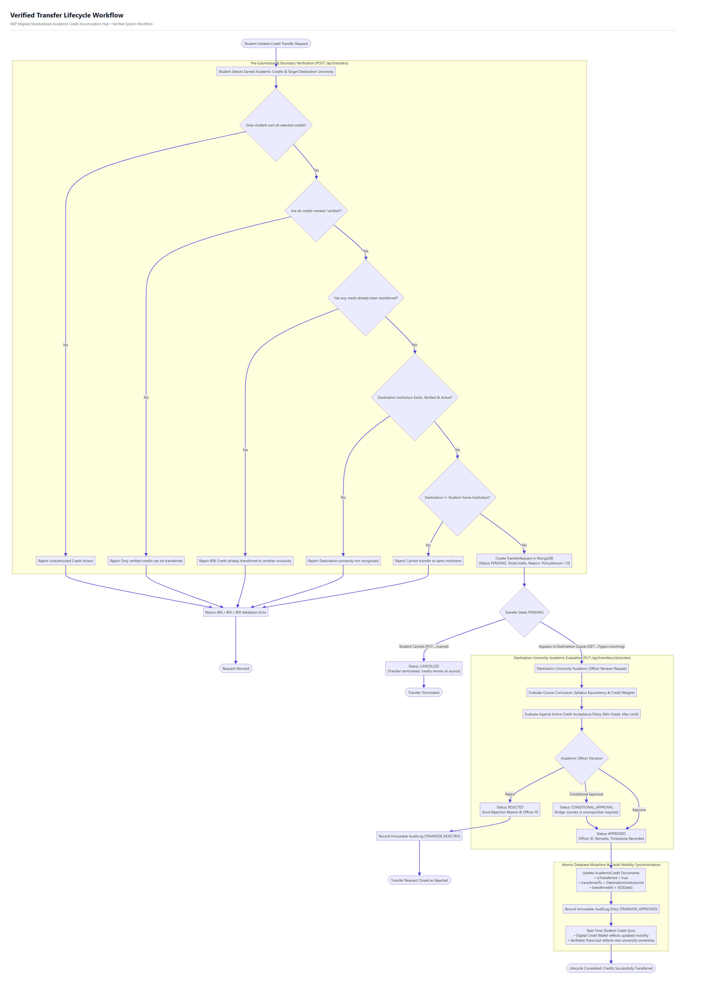
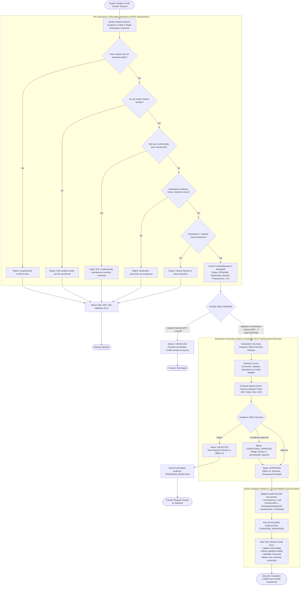
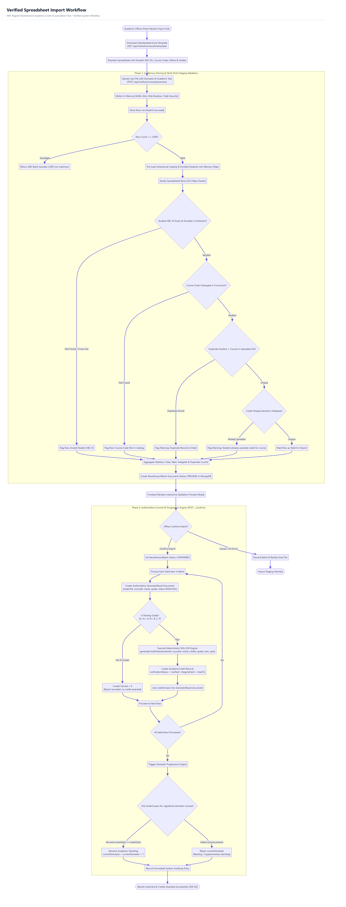
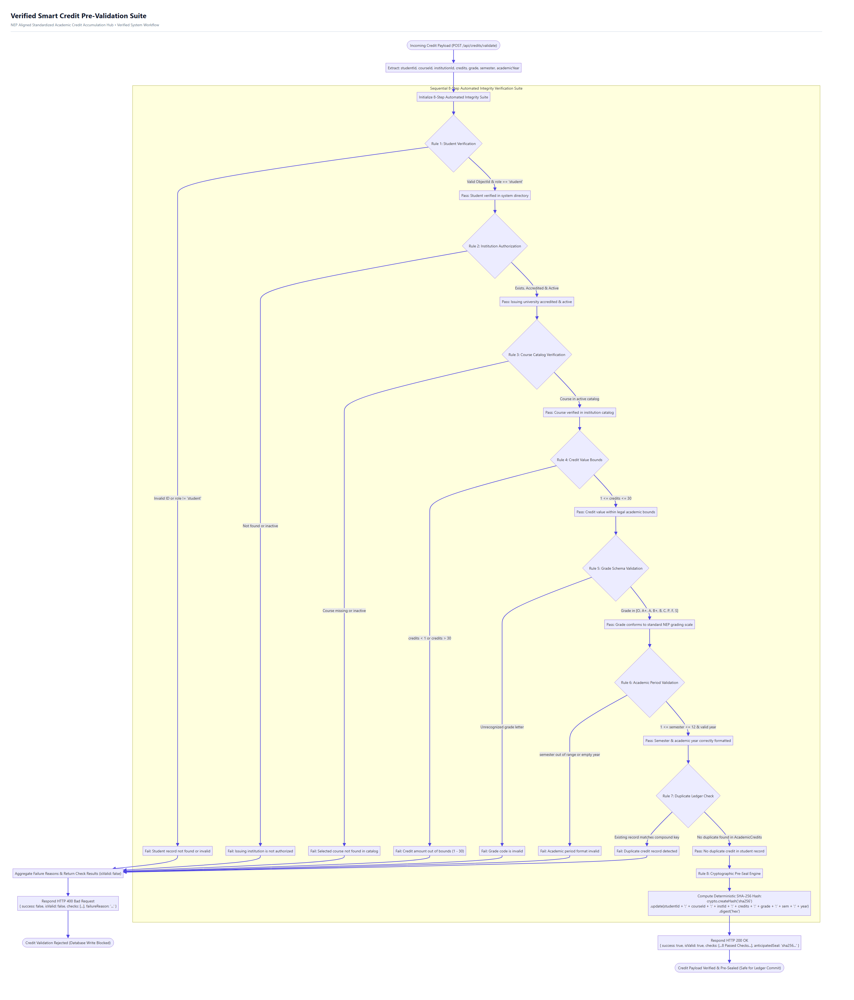
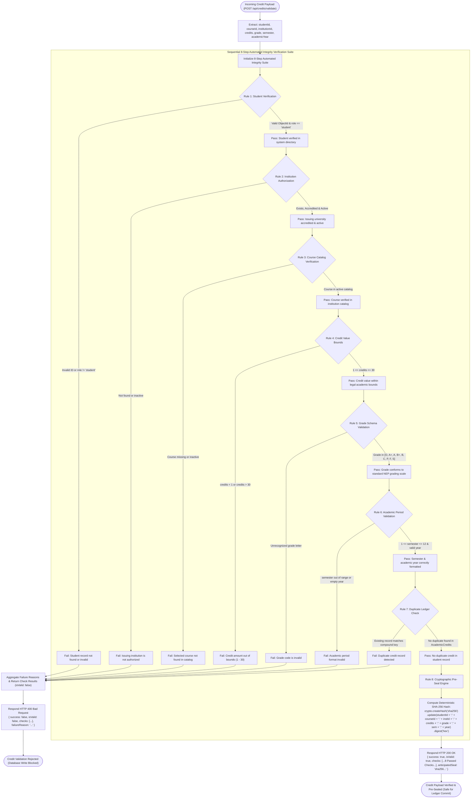
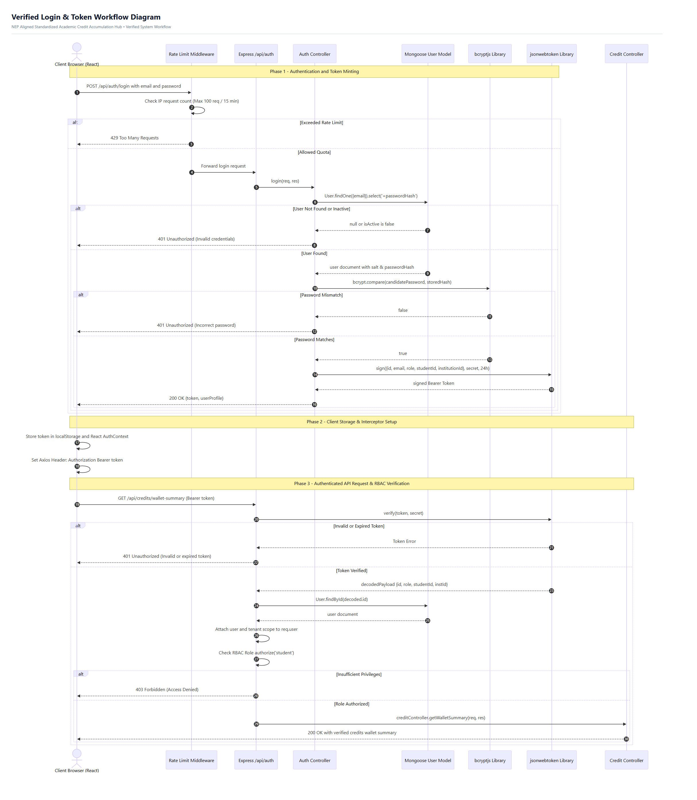
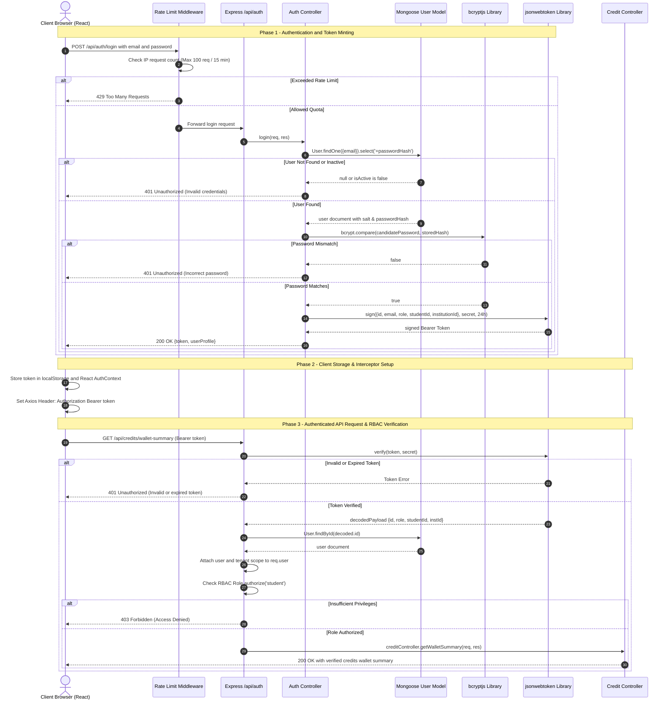
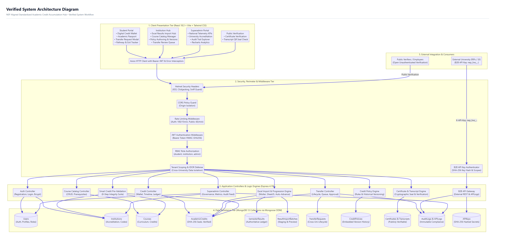
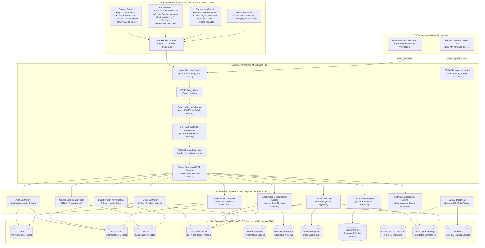

```mermaid
flowchart TD
    Start(["Academic Officer Enters Results Import Hub"]) --> DownloadTemplate["Download Standardized Excel Template<br>(GET /api/institution/results/template)"]
    DownloadTemplate --> FillSpreadsheet["Populate Spreadsheet with Student ABC IDs, Course Codes, Marks & Grades"]
    FillSpreadsheet --> UploadExcel["Upload .xlsx File with Semester & Academic Year<br>(POST /api/institution/results/preview)"]

    subgraph Phase1_Staging ["Phase 1: In-Memory Parsing & Multi-Point Staging Validation"]
        UploadExcel --> MulterMem["Multer In-Memory Buffer (Zero Disk Residue / High Security)"]
        MulterMem --> SheetJS["Parse Rows via SheetJS xlsx.read()"]
        SheetJS --> BatchLimit{"Row Count <= 2,000?"}
        BatchLimit -->|"Exceeded"| LimitErr["Return 400: Batch exceeds 2,000 row maximum"]
        
        BatchLimit -->|"Valid"| LoadDB["Pre-load Institutional Catalog & Enrolled Students into Memory Maps"]
        LoadDB --> RowLoop["Iterate Spreadsheet Rows (O(1) Map Checks)"]
        
        RowLoop --> CheckAbcId{"Student ABC ID Exists & Enrolled in Institution?"}
        CheckAbcId -->|"Not Found / Cross-Inst"| ErrStudent["Flag Row: Invalid Student ABC ID"]
        
        CheckAbcId -->|"Verified"| CheckCourseCode{"Course Code Cataloged in Curriculum?"}
        CheckCourseCode -->|"Not Found"| ErrCourse["Flag Row: Course Code Not in Catalog"]
        
        CheckCourseCode -->|"Verified"| CheckInFileDup{"Duplicate Student + Course in Uploaded File?"}
        CheckInFileDup -->|"Duplicate Found"| WarnFileDup["Flag Warning: Duplicate Record in Sheet"]
        
        CheckInFileDup -->|"Unique"| CheckDbDup{"Credit Already Earned in Database?"}
        CheckDbDup -->|"Already Awarded"| WarnDbDup["Flag Warning: Student already awarded credit for course"]
        
        CheckDbDup -->|"Unique"| MarkValidRow["Mark Row as Valid for Import"]
        
        ErrStudent --> CompileStats
        ErrCourse --> CompileStats
        WarnFileDup --> CompileStats
        WarnDbDup --> CompileStats
        MarkValidRow --> CompileStats["Aggregate Statistics: Total, Valid, Ineligible & Duplicate Counts"]
        
        CompileStats --> SaveBatch["Create ResultImportBatch Document (Status: PREVIEW) in MongoDB"]
    end

    SaveBatch --> ReturnPreview["Frontend Renders Interactive Validation Preview Modal"]
    ReturnPreview --> OfficerAction{"Officer Confirms Batch?"}
    
    OfficerAction -->|"Cancel / Fix Errors"| AbortBatch["Discard Batch & Rectify Excel File"]
    AbortBatch --> AbortedEnd(["Import Staging Aborted"])

    subgraph Phase2_Execution ["Phase 2: Authoritative Commit & Progression Engine (POST .../confirm)"]
        OfficerAction -->|"Confirm Import"| LockBatch["Set ResultImportBatch Status: CONFIRMED"]
        LockBatch --> LoopValid["Process Each Valid Item in Batch"]
        
        LoopValid --> CreateSemResult["Create Authoritative SemesterResult Document:<br>studentId, courseId, marks, grade, status (PASS/FAIL)"]
        CreateSemResult --> GradeCheck{"Is Passing Grade?<br>(O, A+, A, B+, B, C, P)"}
        
        GradeCheck -->|"Fail (F Grade)"| ZeroCred["Credits Earned = 0<br>(Result recorded, no credit awarded)"]
        ZeroCred --> NextItem["Proceed to Next Row"]
        
        GradeCheck -->|"Pass"| GenHash["Execute Deterministic SHA-256 Engine:<br>generateCreditHash(studentId, courseId, instId, credits, grade, sem, year)"]
        GenHash --> CreateCredit["Create AcademicCredit Record:<br>verificationStatus = 'verified', integrityHash = sha256"]
        CreateCredit --> LinkRecord["Link creditId back into SemesterResult document"]
        LinkRecord --> NextItem
        
        NextItem --> AllRowsDone{"All Valid Rows Processed?"}
        AllRowsDone -->|"No"| LoopValid
        AllRowsDone -->|"Yes"| EvaluateProgression["Trigger Semester Progression Engine"]
        
        EvaluateProgression --> CheckAllPassed{"Did student pass ALL registered semester courses?"}
        CheckAllPassed -->|"Yes and currentSem == batchSem"| AdvanceSem["Advance Academic Standing:<br>currentSemester = currentSemester + 1"]
        CheckAllPassed -->|"Failed courses present"| RetainSem["Retain currentSemester<br>(Backlog / Supplementary standing)"]
        
        AdvanceSem --> WriteAuditLog["Record Immutable System AuditLog Entry"]
        RetainSem --> WriteAuditLog
    end

    WriteAuditLog --> CompleteSuccess(["Results Imported & Credits Awarded Successfully (200 OK)"])
```

# VERIFIED WORKFLOW & ARCHITECTURAL DIAGRAMS

This document contains all production-verified architectural diagrams and workflow specifications for the **NEP Aligned Standardized Academic Credit Accumulation Hub with Cross-Institutional Authentication API Gateways**.

All diagrams have been verified directly against the underlying codebase (`server/controllers`, `server/models`, `server/middleware`, and `client/src`) and rendered in both **Lossless Vector SVG** and **Ultra High-Resolution PNG** formats.

Interactive gallery and batch downloader: [`project-documentation/diagrams/index.html`](./diagrams/index.html)

---

## 1. Verified Transfer Lifecycle Diagram

> **Placeholder:** *Insert the verified transfer lifecycle diagram here*

### Diagram Description
Documents the multi-tenant state and sequence lifecycle of inter-university academic credit transfers:
1. **Pre-Submission Invariant Check (`POST /api/transfers`)**: Confirms student ownership, verifies credit status is `verified`, checks credits have not already been transferred (`isTransferred === false`), verifies destination university accreditation and active status (`verificationStatus === 'VERIFIED'`), and ensures destination differs from source.
2. **Queueing & State Machine**: Transitions to `PENDING` state and appears in the student's outgoing queue and the destination institution's review queue (`GET /api/transfers?type=incoming`).
3. **Institutional Evaluation (`PUT /api/transfers/:id/review`)**: Destination Academic Officer evaluates curriculum equivalency, course weights, and institutional credit policy rules.
4. **Final Decision & Atomic Persistence**: Status transitions to `APPROVED`, `CONDITIONAL_APPROVAL`, or `REJECTED`. On approval, the database atomically updates `AcademicCredit` records (`isTransferred = true`, `transferredTo = destId`, `transferredAt = ISODate()`) and records an immutable `AuditLog` entry.
5. **Student Cancellation**: Student can cancel anytime while status remains `PENDING` (`PUT /api/transfers/:id/cancel`).

### Downloadable Picture Links
- **High-Resolution PNG:** [1_transfer_lifecycle.png](./diagrams/1_transfer_lifecycle.png)
- **Lossless Vector SVG:** [1_transfer_lifecycle.svg](./diagrams/1_transfer_lifecycle.svg)

### Embedded Diagram

---

## 2. Verified Spreadsheet Import Workflow

> **Placeholder:** *Insert the verified spreadsheet import workflow here*

### Diagram Description
Documents the two-phase examination ingestion pipeline (`server/controllers/resultImportController.js`):
1. **Template Generation (`GET /api/institution/results/template`)**: Dynamically compiles an institution-customized `.xlsx` template populated with valid student ABC IDs and active course codes.
2. **Phase 1: In-Memory Staging & Validation (`POST /api/institution/results/preview`)**: Uploaded files are buffered in RAM with `multer.memoryStorage()`, parsed with SheetJS (`xlsx.read`), and validated via O(1) in-memory maps against MongoDB:
   - Validates student ABC ID existence and verifies student belongs to the uploading university (flagging cross-institution tampering).
   - Validates course code cataloging within active curriculum.
   - Detects in-file duplicates and identifies credits already awarded in database.
   - Creates a staged `ResultImportBatch` document (`status: 'PREVIEW'`) with aggregate telemetry.
3. **Officer Review**: Frontend renders an interactive preview modal showing valid rows, duplicates, and errors.
4. **Phase 2: Authoritative Confirmation (`POST /api/institution/results/confirm`)**: 
   - Batch locks to `CONFIRMED`.
   - Creates authoritative `SemesterResult` documents.
   - Passing grades (`O, A+, A, B+, B, C, P`) trigger the deterministic SHA-256 seal engine and generate `AcademicCredit` records.
   - Triggers the **Semester Progression Algorithm**: If student passed all registered courses for their current semester, standing advances ($N \rightarrow N+1$); otherwise, the student retains current semester with backlogs.
   - Writes immutable `AuditLog` entry.

### Downloadable Picture Links
- **High-Resolution PNG:** [2_spreadsheet_import.png](./diagrams/2_spreadsheet_import.png)
- **Lossless Vector SVG:** [2_spreadsheet_import.svg](./diagrams/2_spreadsheet_import.svg)

### Embedded Diagram

---

## 3. Verified Credit Validation Workflow

> **Placeholder:** *Insert the verified credit validation workflow here*

### Diagram Description
Documents the 8-rule automated pre-validation engine (`server/controllers/validationController.js`, `POST /api/credits/validate`):
1. **Rule 1: Student Verification**: Confirms MongoDB `ObjectId` format, verifies user exists, and enforces `role === 'student'`.
2. **Rule 2: Institution Authorization**: Verifies institution exists, has accreditation status `VERIFIED`, and `isActive === true`.
3. **Rule 3: Course Catalog Verification**: Checks that course exists in the institution's active catalog.
4. **Rule 4: Credit Value Bounds**: Enforces integer bounds $1 \le \text{credits} \le 30$.
5. **Rule 5: Grade Schema Validation**: Checks grade letter against standard NEP grading scale `['O', 'A+', 'A', 'B+', 'B', 'C', 'P', 'F', 'S']`.
6. **Rule 6: Academic Period Validation**: Validates $1 \le \text{semester} \le 12$ and validates non-empty academic year string.
7. **Rule 7: Duplicate Ledger Check**: Queries `AcademicCredit.findOne({ studentId, courseId, semester, academicYear })` to guarantee idempotent ledger integrity and prevent double accumulation.
8. **Rule 8: Cryptographic Pre-Seal Engine**: Computes and returns the anticipated deterministic SHA-256 integrity seal before database write:
   $$\text{Seal} = \text{SHA256}(\text{studentId} \parallel \text{courseId} \parallel \text{instId} \parallel \text{credits} \parallel \text{grade} \parallel \text{sem} \parallel \text{year} \parallel \text{PEPPER})$$

### Downloadable Picture Links
- **High-Resolution PNG:** [3_credit_validation.png](./diagrams/3_credit_validation.png)
- **Lossless Vector SVG:** [3_credit_validation.svg](./diagrams/3_credit_validation.svg)

### Embedded Diagram

---

## 4. Verified Login and Token Workflow Diagram

> **Placeholder:** *Insert the verified login and token workflow diagram here*

### Diagram Description
Documents user authentication and session security across the full stack (`server/controllers/authController.js`, `server/middleware/auth.js`, `server/middleware/rateLimiter.js`):
1. **Perimeter Rate Limiting**: Client `POST /api/auth/login` is inspected by `rateLimiter` (100 req / 15 min per IP); prevents credential brute-forcing.
2. **Bcrypt Verification**: `User.findOne({ email }).select('+passwordHash')` retrieves salted hash; `bcrypt.compare` executes with work factor 12.
3. **JWT Minting**: Signs ephemeral 24-hour token with HMAC-SHA256 payload `{ id, email, role, studentId, institutionId }`.
4. **Client-Side Interceptors**: React stores token in `localStorage` and injects `Authorization: Bearer <token>` into all Axios requests.
5. **Protected Route Verification**: `authMiddleware` verifies signature, checks 24-hour expiration, queries MongoDB for user validity, attaches user and tenant scope to `req.user`, and verifies role permissions via `authorize('student', 'institution', 'admin')`.

### Downloadable Picture Links
- **High-Resolution PNG:** [4_login_token_workflow.png](./diagrams/4_login_token_workflow.png)
- **Lossless Vector SVG:** [4_login_token_workflow.svg](./diagrams/4_login_token_workflow.svg)

### Embedded Diagram

---

## 5. Verified System Architecture Diagram

> **Placeholder:** *Insert the verified system architecture diagram here*

### Diagram Description
Documents the complete 5-tier architecture of the platform:
1. **Presentation Layer (React 18.3 + Vite + Tailwind CSS)**: Four tailored web portals (Student, Institution, Superadmin, Public Verifier) with Axios interceptors.
2. **Security & Perimeter Layer**: Helmet headers, strict CORS, rate limiters, JWT bearer tokens, role authorization (RBAC), multi-tenant scoping, and B2B API Key verification (`X-API-Key: nep_live_...`).
3. **Application & Engine Layer (Express 4.19)**: 11 specialized controllers handling credit ledgers, transfer state machines, Excel result ingestion, SHA-256 seal computation, certificate issuance, and B2B API gateway routing.
4. **Data Persistence Tier (MongoDB 13 Collections)**: Enforced via Mongoose ODM models with compound indexing, unique constraints, and schema validations.
5. **External Integration Tier**: External university ERPs and public verifiers accessing verifiable endpoints.

### Downloadable Picture Links
- **High-Resolution PNG:** [5_system_architecture.png](./diagrams/5_system_architecture.png)
- **Lossless Vector SVG:** [5_system_architecture.svg](./diagrams/5_system_architecture.svg)

### Embedded Diagram

---

## 6. Diagram Inventory & Download Manifest

| # | Workflow / Architecture Component | High-Res PNG File | Vector SVG File |
| :---: | :--- | :--- | :--- |
| **1** | Verified Transfer Lifecycle Diagram | [`1_transfer_lifecycle.png`](./diagrams/1_transfer_lifecycle.png) | [`1_transfer_lifecycle.svg`](./diagrams/1_transfer_lifecycle.svg) |
| **2** | Verified Spreadsheet Import Workflow | [`2_spreadsheet_import.png`](./diagrams/2_spreadsheet_import.png) | [`2_spreadsheet_import.svg`](./diagrams/2_spreadsheet_import.svg) |
| **3** | Verified Credit Validation Workflow | [`3_credit_validation.png`](./diagrams/3_credit_validation.png) | [`3_credit_validation.svg`](./diagrams/3_credit_validation.svg) |
| **4** | Verified Login and Token Workflow Diagram | [`4_login_token_workflow.png`](./diagrams/4_login_token_workflow.png) | [`4_login_token_workflow.svg`](./diagrams/4_login_token_workflow.svg) |
| **5** | Verified System Architecture Diagram | [`5_system_architecture.png`](./diagrams/5_system_architecture.png) | [`5_system_architecture.svg`](./diagrams/5_system_architecture.svg) |
| **UI** | Interactive All-in-One Diagram Viewer & Downloader | [`index.html`](./diagrams/index.html) | Open in browser to preview and download all files |
